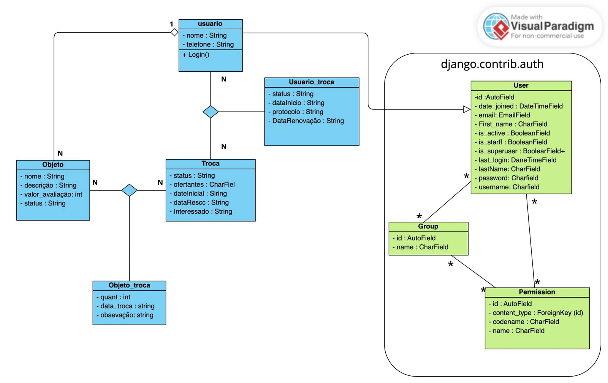

# Consumo Consciente e Trocas Locais

## Sobre o projeto

O **Consumo Consciente e Trocas Locais** é uma aplicação web desenvolvida com Django que tem como objetivo incentivar o consumo consciente por meio da troca e da doação de objetos entre pessoas de uma mesma região.

A plataforma permite que os usuários cadastrem objetos, participem de propostas de troca e acompanhem as negociações realizadas. Dessa forma, busca estimular o reaproveitamento de bens, reduzir o descarte desnecessário e fortalecer as relações de colaboração na comunidade.

## Tecnologias utilizadas

- Python 3.14.3
- Django 6.0.3
- Pillow 13.0.0
- SQLite
- HTML e CSS
- Git e GitHub

## Organização do projeto

O sistema está dividido em cinco aplicações Django:

- **usuario:** responsável pelas funcionalidades relacionadas aos usuários.
- **objetos:** responsável pelo cadastro, consulta e gerenciamento dos objetos disponibilizados.
- **trocas:** responsável pelo gerenciamento das propostas e dos processos de troca.
- **UsuarioTroca:** gerencia a relação entre usuários e trocas.
- **ObjetoTroca:** gerencia a associação entre objetos e trocas.

A aplicação também utiliza o sistema de autenticação integrado do Django para o gerenciamento de acesso dos usuários.

## Diagrama de classes

O diagrama apresenta a estrutura das entidades do sistema e seus relacionamentos.



## Requisitos para execução

Antes de iniciar, é necessário ter instalado:

- Python 3.14.3 ou versão compatível.
- Git.

## Instalação e execução

### 1. Clonar o repositório

```bash
git clone https://github.com/Benifalcao/ProjetoFinal--PCC.git
```

### 2. Acessar a pasta do projeto

```bash
cd ProjetoFinal--PCC
```

### 3. Criar o ambiente virtual

```bash
py -m venv venv
```

### 4. Ativar o ambiente virtual

No Windows PowerShell:

```powershell
.\venv\Scripts\Activate.ps1
```

### 5. Instalar as dependências

```bash
python -m pip install -r requirements.txt
```

### 6. Acessar a pasta que contém o projeto Django

```bash
cd TLC
```

### 7. Aplicar as migrações do banco de dados

```bash
python manage.py migrate
```

### 8. Criar um superusuário

```bash
python manage.py createsuperuser
```

Siga as instruções exibidas no terminal para cadastrar as credenciais de administrador.

### 9. Iniciar o servidor

```bash
python manage.py runserver
```

### 10. Acessar a aplicação

Abra o navegador e acesse:

- Aplicação: http://127.0.0.1:8000/
- Administração Django: http://127.0.0.1:8000/admin/

## Observações

O banco de dados SQLite é criado localmente por meio das migrações. As imagens enviadas durante o uso da aplicação são armazenadas na pasta `media`, que não é incluída no repositório.